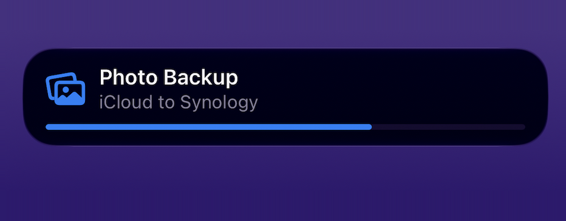
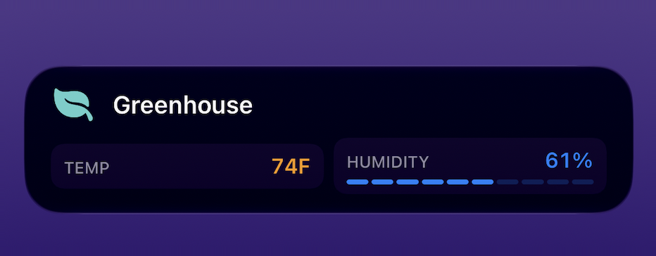
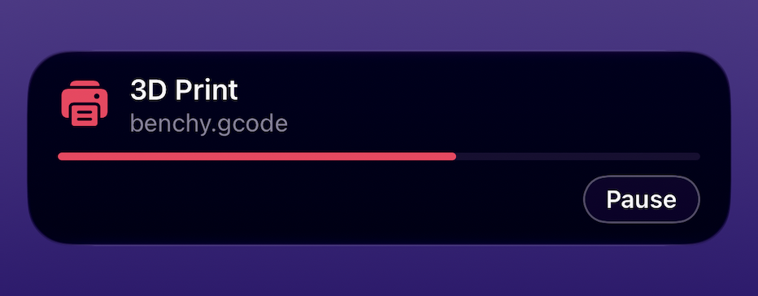

# notify-bambuddy

Turns BambuBuddy print jobs into **Notify! Live Activities** on iOS: one Lock
Screen tile per printer that appears when a print starts, updates itself while
it runs, and disappears when it finishes.

```
┌──────────────────────────────────────────────┐
│  🖨  X1C-1                          1:47:12  │
│     Articulated Dragon                       │
│     ████████████████░░░░░░░░░░░░░░░░  62%    │
└──────────────────────────────────────────────┘
```

No unlocking, no opening an app, no stack of "50% done" notifications. The
countdown ticks on the device itself, so a whole print costs a handful of
pushes rather than one every few minutes.

It is an independent community add-on. It does not modify BambuBuddy or
Notify, it reads through BambuBuddy's own documented API, and if it stops
running your printers do not notice.

**One container, one API key.** Nothing to install alongside it, and nothing
to configure inside BambuBuddy beyond issuing the key.

---

## What it does

- **One tile per printer.** Several printers run side by side without
  overwriting each other.
- **A live countdown**, from the printer's own ETA, converted to the units
  Notify expects. (BambuBuddy reports `remaining_time` in MINUTES. Its own
  documentation makes them look like seconds. This is the single most common
  way to get this integration wrong, and it is the difference between a two
  hour countdown and a two minute one.)
- **Pause and resume**, labelled. A pause is shown as "Paused" with no stated
  cause, because BambuBuddy's status route reports no error codes.
- **Completion and failure**, ending the tile with the right outcome.
- **Push notifications for the moments that matter**, alongside the tiles:
  print finished, print failed, printer stopped responding.
  Problem alerts can break through Do Not Disturb.
- **Survives restarts.** Yours and BambuBuddy's. It reattaches
  to tiles that are still on screen instead of orphaning them or creating
  duplicates.
- **Respects a swipe.** Dismiss a tile and it stays gone until the next print.
- **The tile is yours to shape.** A smooth percentage bar, discrete segments,
  or no bar at all; optional metric chips and a tappable button. All optional:
  set nothing and you get a sensible tile. See
  [Choosing how the tile looks](#choosing-how-the-tile-looks).
- **No iPhone required.** A browser subscription gets the same print-started,
  finished and failed notifications, on any device that can receive web push.
  There is no Lock Screen tile in that case, because that part is iOS only.
  See [Without an iPhone](#without-an-iphone).

## What it deliberately does not do

- Talk to your printers. It never opens a connection to one.
- Control anything. No pause, resume, stop, or upload. The API key it uses
  needs the `read_status` permission and nothing else, and the code contains
  no call to any endpoint that could change something.
- Listen on a port. Both of its connections are outbound, so there is nothing
  to reverse-proxy and nothing to forward. BambuBuddy never has to reach it.
- Require a cloud account beyond the Notify app you already installed.

---

## How it works

```
   ┌─────────────┐   HTTPS: GET printer status    ┌──────────────────┐
   │ BambuBuddy  │ ◄───────────────────────────── │ notify-bambuddy  │
   └─────────────┘        X-API-Key: bb_...       └────────┬─────────┘
          ▲                                                │ HTTPS
          │                                                ▼
   ┌──────┴──────┐                               ┌──────────────────┐
   │  printers   │                               │ push.getnotify   │
   └─────────────┘                               │ app.com          │
                                                 └────────┬─────────┘
                                                          │ APNs
                                                          ▼
                                                    ┌───────────┐
                                                    │  iPhone   │
                                                    └───────────┘
```

BambuBuddy already tracks every printer and already exposes that state to
API-key holders. This service asks for it on a timer, works out what each
printer is actually doing, and drives the matching Live Activity through
Notify's HTTPS API. It makes two kinds of outbound request and accepts none.

The polling is cheaper than it sounds. One small JSON response per printer per
poll, on your own LAN, and the interval backs right off when nothing is
printing. The Live Activity countdown is a **relative** one: iOS ticks it down
on the device, so a whole print costs a handful of pushes no matter how often
this service looks.

## What you need

- **BambuBuddy**, and the ability to create an API key in it.
- **An iPhone or iPad** running [Notify!](https://getnotifyapp.com), with your
  **Device ID** and **Token** from **Settings → Device**. Open the app once
  after installing it: that first launch is what lets a tile appear while the
  app is closed.

  A **browser subscription works too**, with the device id that starts `WB`.
  A Live Activity is an iOS Lock Screen feature, so there is no tile in that
  case, but every print is still followed and you still get a notification
  when one starts, finishes or fails. Nothing to configure: the service works
  out which it is from the id.
- **Docker**, wherever BambuBuddy already runs.

The device token is a credential. Treat it like a password.

---

## Setup

### 1. Create an API key in BambuBuddy

**Settings → API Keys → New key**, with the **`read_status`** permission.

That is the only permission this uses, and giving it more does not enable
anything: there is no code path here that calls a control endpoint. If your
BambuBuddy scopes keys to specific printers, scope it to the ones you want on
your Lock Screen.

Copy the key. It is shown once.

Worth thirty seconds before going further:

```bash
curl -s -H "X-API-Key: bb_YOUR_KEY" http://YOUR_BAMBUDDY:8000/api/v1/webhook/queue
```

That should list your printers. If it does not, fix that first: this add-on
sees exactly what that command sees and no more.

### 2. Run it

**If BambuBuddy runs in Docker Compose**, add one service to the same
`docker-compose.yml` it is already in. Being in that file is what lets you
write `http://bambuddy:8000` instead of hunting for an IP address, and it
means the two start and stop together.

```yaml
  notify-bambuddy:
    image: ghcr.io/simplytoast1/notify-bambuddy:0.4.1
    container_name: notify-bambuddy
    restart: on-failure:5
    environment:
      BAMBUDDY_URL: "http://bambuddy:8000"
      BAMBUDDY_API_KEY: "bb_paste_your_key_here"
      NOTIFY_DEVICE_ID: "ABC12345"
      NOTIFY_DEVICE_TOKEN: "paste_your_token_here"
      DRY_RUN: "1"
    volumes:
      - notify-bambuddy-state:/data
```

Add the volume alongside the ones already there:

```yaml
volumes:
  notify-bambuddy-state:
```

Then:

```bash
docker compose up -d notify-bambuddy && docker compose logs -f notify-bambuddy
```

Change `bambuddy` in the URL to whatever BambuBuddy's service is actually
called in that file, and `8000` to the port it listens on **inside** the
container, which is not always the one you browse to.

**Or give it its own Compose project**, which is the tidier option if
BambuBuddy is managed separately or lives on another machine. Make a directory
with a `docker-compose.yml`:

```yaml
services:
  notify-bambuddy:
    image: ghcr.io/simplytoast1/notify-bambuddy:0.4.1
    container_name: notify-bambuddy
    restart: on-failure:5
    env_file: [.env]
    volumes:
      - notify-bambuddy-state:/data

volumes:
  notify-bambuddy-state:
```

and a `.env` beside it, `chmod 600`, holding the four values. Then
`docker compose up -d`. This repository's own
[`compose.yaml`](compose.yaml) is that file, with the hardening options
(read-only root, all capabilities dropped, a memory ceiling) already set.

**Or one command, with no files at all:**

```bash
docker run -d --name notify-bambuddy --restart on-failure:5 -v notify-bambuddy-state:/data -e BAMBUDDY_URL="http://192.168.1.50:8000" -e BAMBUDDY_API_KEY="bb_paste_your_key_here" -e NOTIFY_DEVICE_ID="ABC12345" -e NOTIFY_DEVICE_TOKEN="paste_your_token_here" -e DRY_RUN=1 ghcr.io/simplytoast1/notify-bambuddy:0.4.1
```

```bash
docker logs -f notify-bambuddy
```

**Leave `DRY_RUN` on for the first run.** It tracks every printer and logs
exactly what it would send, without creating a single tile. Set it to `0` and
restart once the log looks right.

Keep the volume. Without it a restart cannot reattach to tiles still on your
Lock Screen, and cannot remember which ones you swiped away.

### 3. Check it

At startup the service validates your Notify credentials and says what they
point at:

```
Notify credentials are valid: device ABC12345 (iPhone)
BambuBuddy has 4 printer(s): Workshop H2C (id 1), Office X2D (id 2), ...
notify-bambuddy 0.1.0 is running
```

Start a print. Within a poll interval:

```
Print started on Workshop H2C: Articulated Dragon
Started tile LA7Q2ZKM for bb1
```

With `PRIVACY_MODE=1` the job name reads `(hidden)` there too: a log file is at
least as likely to be shared as a Lock Screen photo.

`bb1` is the session key. The REST API identifies printers by BambuBuddy's own
database id rather than by serial, so it keys everything by
`bb<id>`. To watch only some printers here, use **`BAMBUDDY_PRINTER_IDS=1,3`**,
which takes plain ids and is checked before a request is even made.
`PRINTER_ALLOWLIST` still works but matches the session key, so it wants
`bb1,bb3`.

To try everything except the pushing:

```bash
docker compose run --rm -e DRY_RUN=1 notify-bambuddy
```

That tracks every printer and logs exactly what it would send, without
creating, updating or ending a single tile. It still validates your
credentials on the way up, which is the part you want checked anyway.

---

## Removing it

Nothing on your printers or in BambuBuddy changes when it goes. It only ever
read.

**If you added it to a compose file**, delete the `notify-bambuddy:` service
block and the `notify-bambuddy-state:` volume entry, then:

```bash
docker compose down notify-bambuddy && docker volume rm notify-bambuddy-state
```

**If you used `docker run`:**

```bash
docker rm -f notify-bambuddy && docker volume rm notify-bambuddy-state && docker rmi ghcr.io/simplytoast1/notify-bambuddy:0.4.1
```

That is everything. Nothing was installed outside the container, so there are
no packages, services, users or files left behind on the host.

Two things no uninstall can do for you:

- **Revoke the API key**, in BambuBuddy under **Settings → API Keys**. Worth
  doing even though it only ever had read access.
- **Clear a tile still on your phone.** Swipe it away. Nothing is updating it
  any more, so it expires on its own too.

---

## Configuration

Four variables are required. Everything else has a working default.

| Variable | Default | What it is |
|---|---|---|
| `BAMBUDDY_URL` | *required* | BambuBuddy's base address, as you browse to it |
| `BAMBUDDY_API_KEY` | *required* | A `read_status` key. A credential |
| `NOTIFY_DEVICE_ID` | *required* | From Notify → Settings → Device |
| `NOTIFY_DEVICE_TOKEN` | *required* | From the same screen. A credential |
| `BAMBUDDY_POLL_SECONDS` | `10` | How often to ask, while something is printing |
| `BAMBUDDY_PRINTER_IDS` | all | Comma-separated printer ids, e.g. `1,3` |
| `ALERTS` | `all` | `all`, `problems`, or `off` |
| `PRIVACY_MODE` | `false` | Hide filenames from the Lock Screen |
| `MAX_TILES` | `5` | Notify's limit is 5 live tiles per device |
| `TILE_PROGRESS` | `bar` | `bar`, `segments`, or `off`. See above |
| `TILE_METRICS` | `false` | Chips instead of the model name |

The full list, with the reasoning behind every default, is in
[`.env.example`](.env.example) and
[`docs/CONFIGURATION.md`](docs/CONFIGURATION.md).

Secrets can be supplied as files instead of variables, which is how Docker and
Kubernetes secrets are mounted:

```bash
NOTIFY_DEVICE_TOKEN_FILE=/run/secrets/notify_token
BAMBUDDY_API_KEY_FILE=/run/secrets/bambuddy_key
```

Both are redacted from every log line, including tracebacks raised from inside
urllib, so neither should ever appear in your logs.

---

## Choosing how the tile looks

**You do not need any of this.** Set nothing and you get a printer name, the
model name, a percentage bar, a live countdown and a status word, which is what
most people want. This section is only here if you want something different.

Notify has no "tile type" to pick. The fields you send *are* the layout, and
they combine, so these options are independent switches rather than a menu of
presets.

### The progress indicator

`TILE_PROGRESS` chooses which kind of bar the tile draws, or none at all.

**`bar`** is the default: a smooth percentage bar moving continuously from 0
to 100.



**`segments`** draws discrete blocks that light as the print passes each
share. The widget shows the fraction alongside them.


**`off`** draws no bar. The countdown and the status word carry the tile,
which is calmer than it sounds.


With `segments`, `TILE_SEGMENTS` sets how many blocks there are (2 to 20,
default 10). A block lights only once its share is genuinely finished, so ten
blocks means one lights every 10%. It rounds down deliberately: a bar that
fills at 95% spends the last minutes of a print claiming to be done.

```bash
TILE_PROGRESS=segments
TILE_SEGMENTS=8
```

`off` is more useful than it sounds. A tile reading **X1C** / **mascot.3mf** /
**47 min** with no bar is calm and completely legible, and the countdown is the
number most people actually read.

### Metric chips

`TILE_METRICS=true` swaps the second line for small labelled chips: progress,
time left and status.



It is off by default for one reason: **the chips take the place of the model
name.** If knowing which print is running matters more to you than the numbers,
leave it off.

A chip whose value ends in `%` renders its own miniature bar, as the humidity
chip above shows, so this pairs well with `TILE_PROGRESS=off`. Two chips are
sent, progress and time left, because two is what fits a phone comfortably.
The status word is not repeated as a chip: it already appears in the tile's
trailing slot.

### A button

`TILE_BUTTON_URL` adds a tappable button to the tile.



```bash
TILE_BUTTON_URL=https://bambuddy.example.com/
TILE_BUTTON_TITLE=Open        # up to 20 characters, default "Open"
TILE_BUTTON_OPEN=true         # true opens the link, false fires it silently
```

Notify requires **https** here, so a plain `http://192.168.1.50:8000` LAN
address will be refused at startup rather than failing quietly on your phone.
If BambuBuddy is not behind TLS, leave this unset.

> The tiles above are Notify's own examples, from
> [getnotifyapp.com/apidocs](https://getnotifyapp.com/apidocs/). They show the
> shape each setting produces, not this integration's own output, which puts
> your printer name on the first line and the model name on the second.

### Colour and icon

`NOTIFY_TINT` (default `#00A76F`) sets the accent colour, as `#RRGGBB` or
`#AARRGGBB`. `NOTIFY_SYMBOL` (default `printer.fill`) is any
[SF Symbol](https://developer.apple.com/sf-symbols/) name.

### Mixing them

The options compose, so pick per taste rather than per preset:

```bash
# Minimal: just a countdown and a word
TILE_PROGRESS=off

# Dashboard: chips with their own mini bars, no big bar
TILE_PROGRESS=off
TILE_METRICS=true

# Blocky: segments instead of a smooth bar, model name kept
TILE_PROGRESS=segments
TILE_SEGMENTS=10
```

Changes take effect on the **next tile**, not the current one. A print already
running keeps the layout it started with, which avoids a tile visibly
rearranging itself mid-print.

---

## Without an iPhone

A Live Activity is an iOS Lock Screen feature, so a tile needs an iPhone or
iPad. **Everything else works without one.**

Notify can register a **browser subscription** through its web app, which gives
you a device id starting `WB`. Put that in `NOTIFY_DEVICE_ID` with its token
and the service runs in notifications-only mode:

```bash
NOTIFY_DEVICE_ID=WB1a2b3c4d5e6f7g
NOTIFY_DEVICE_TOKEN=your_token_here
```

**There is nothing to configure.** The service works out which kind of
subscription it has from the shape of the id and says so once at startup:

```
That device is a browser subscription, so there will be no Lock Screen tiles:
a Live Activity is an iOS feature. Every print is still followed, and you still
get a notification when one starts, finishes or fails.
```

Web push is delivered by the browser, so it reaches Chrome, Firefox and Edge on
Windows, macOS, Linux and Android, and Safari on macOS. Notifications arrive
whether or not the tab is open, because the browser holds the subscription
rather than the page.

What changes in this mode:

| | iPhone or iPad | Browser subscription |
|---|---|---|
| Lock Screen tile, live progress, countdown | Yes | No |
| Print started | No (the tile is the announcement) | **Yes** |
| Print finished, print failed | Yes | Yes |
| Printer stopped responding | Yes | Yes |
| Break through Do Not Disturb | Yes | Browser and OS dependent |

The **print started** notification is sent *only* in this mode. On an iPhone
the tile appearing is the announcement, so a notification saying the same thing
would be noise. With no tile, nothing else would tell you a print had begun.

Everything else is unchanged. Prints are still tracked the whole way through,
multiple printers still work, restarts still recover, and outcomes are still
worked out the same way.

Two things are refused at startup rather than failing quietly later:

- **A browser id with `ALERTS=off`** leaves the service nothing at all it is
  permitted to send, so it says so instead of running silently forever.
- **A group id** (one starting `GRP`) is not a device. A tile belongs to one
  specific iPhone, so the error points you at **Settings → Device** in the app
  rather than letting the gateway answer with a bare 403.

---

## Alerts

A tile is the right shape for "62% done, 1:47 left". It is the wrong shape for
"your print failed two hours ago", because tiles end and vanish, and Live
Activity updates are deliberately kept out of Notify's history so that a
printer pushing percent cannot bury everything else you care about.

So the moments that matter get an ordinary push notification as well:

| Alert | `problems` | `all` | Time Sensitive |
|---|:---:|:---:|:---:|
| Print started | | ✓ | |
| Print finished | | ✓ | |
| Print failed or stopped | ✓ | ✓ | ✓ |
| Printer stopped responding | ✓ | ✓ | |

"Print started" is sent only to a browser subscription, where there is no tile
to announce it.

Time Sensitive alerts break through Do Not Disturb and Focus. A successful
print never is: nobody needs to be woken at 3am by good news. Set
`ALERTS=off` for tiles only.

Alerts thread per printer in iOS, so a farm's notifications stack per machine
instead of scattering down the list.

### If you already send BambuBuddy notifications to Notify

**Set `ALERTS=off`.** BambuBuddy ships a generic `webhook` notification
provider, and pointing it at a Notify device URL already delivers print
finished, print failed, printer offline and filament low, with its own quiet
hours and per-printer routing. It also covers things this add-on cannot see at
all, filament runout among them. If you have that set up, leaving alerts on
here means the events they share arrive twice.

That is worth being plain about: **the tile is what this add-on is actually
for.** Ordinary notifications are a solved problem in BambuBuddy already (it
has built-in providers for ntfy, Pushover, Telegram, Discord, Bark, Home
Assistant and a generic webhook). What none of them can do is a Lock Screen
tile that updates in place with a live countdown, because that needs a
continuous view of the print rather than a handful of milestone events. Alerts
are included here only so that a finished print leaves something behind after
its tile disappears, and they are one setting away from being off.

---

## Several printers

Each printer gets its own tile, keyed on a stable per-printer key rather than its
name, so renaming a printer in BambuBuddy does not confuse anything.

Notify allows **five** live tiles per device. A sixth printer is not dropped:
it waits. A freed slot goes to a print that is
actually running before one that is paused or silent, and within that group to
whichever is closest to finishing. If you want to guarantee which printers get
tiles, use `PRINTER_ALLOWLIST`.

---

## Privacy

`PRIVACY_MODE=true` keeps model and file names off the Lock Screen and out of
the alerts. The tile still shows the printer, the state, the progress and the
ETA.

Independently of that setting:

- The Notify device token is redacted from every log line, including
  exceptions raised from inside the HTTP library. The whole query
  string of any Notify URL is dropped before it is logged.
- The health endpoint binds to localhost and exposes no credential. On the
  API source it does report `BAMBUDDY_URL`, which is an address on your own
  network.
- Nothing is sent anywhere except your own BambuBuddy and
  `push.getnotifyapp.com`.

---

## Troubleshooting

**Nothing at all happens.** Check the health endpoint:

```bash
curl -s localhost:9337/status
```

`source.last_error` and `source.seconds_since_success`
say whether BambuBuddy is answering. A rejected API key is fatal at startup and
says so; an unreachable BambuBuddy is retried with backoff, so
`consecutive_failures` climbing while `polls_succeeded` stays put means the URL
or the network, not the key.

If `polls_succeeded` is climbing but no tile appears, the printers are simply
idle as far as BambuBuddy is concerned. Check the same thing this service
checks:

```bash
curl -s -H "X-API-Key: bb_YOUR_KEY" http://YOUR_BAMBUDDY:8000/api/v1/webhook/printer/1/status
```

**The tile never appears, but the log says it started.** Open the Notify app
once on the phone. An app update rotates the credential used to create tiles
while the app is closed, and iOS then discards new tiles silently, with no
error anywhere. This service checks after 90 seconds and says so:

```
Tile LA7Q2ZKM was accepted but has not appeared on the phone. This usually
means iOS is discarding Live Activity starts because Notify's start credential
is stale. Open the Notify app once on the device.
```

**The countdown is wrong by a factor of 60.** That is the bug this project
exists partly to avoid, so if you see it, please open an issue: BambuBuddy
publishes `remaining_time` in minutes, and this service multiplies by 60.

**A tile is stuck showing a print that finished.** Ending it is the one
operation Notify keeps working under every failure mode, so this is usually a
service that stopped running. Restarting reattaches and cleans up.

More in [`docs/TROUBLESHOOTING.md`](docs/TROUBLESHOOTING.md).

---

## How it talks to BambuBuddy

Two endpoints, both `GET`, both requiring only the
`read_status` permission:

| Request | Why |
|---|---|
| `GET /api/v1/webhook/queue` | Discovering which printers exist, and their ids |
| `GET /api/v1/webhook/printer/{id}/status` | State, progress, ETA, job name |

A status response looks like this, verbatim:

```json
{"id":1,"name":"Workshop H2C","connected":true,"state":"RUNNING",
 "current_print":"Articulated Octopus","progress":52.0,"remaining_time":43}
```

`remaining_time` is **43 minutes**, not 43 seconds. BambuBuddy stores the
firmware's `mc_remaining_time` verbatim and this route passes it through
untouched, while other call sites inside BambuBuddy multiply by 60 first. This
service multiplies by 60 exactly once, in one place, with a test that fails if
anyone changes it.

The API key travels in the `X-API-Key` header, never in a URL, so it cannot
end up in a proxy log.

No internal endpoints, no database access, no connection to a printer, and
nothing that writes. Read only, in every sense.

### What is not used, and why

BambuBuddy also has a generic **webhook notification provider**, which is how
some add-ons integrate. It is not used here, deliberately. Its progress event
fires only at the 25%, 50% and 75% milestones, and it reports time remaining
as a preformatted string like `"2h 14m"` rather than a number. A Live Activity
needs a real ETA in seconds and benefits from finer progress than three steps,
so polling gives a better tile for less setup.

---

## For the BambuBuddy developer

If you maintain BambuBuddy, or want to send this upstream:
**[`docs/UPSTREAM.md`](docs/UPSTREAM.md)**.

It covers two independent options. Four fields BambuBuddy already holds in
memory (`layer_num`, `total_layers`, `hms_errors`, `subtask_id`) added to
`GET /api/v1/webhook/printer/{id}/status`, which is twenty minutes and closes
every gap this add-on works around. Or building it in natively as a provider
type, with the plumbing mapped against BambuBuddy's own Bark commit and the
four things that break pre-solved.

It also documents the one thing worth fixing regardless: `remaining_time` is
minutes on that route and seconds in the notification pipeline, and nothing
says so.

---

## Development

```bash
python -m venv .venv && .venv/bin/pip install -e ".[dev]"
```

```bash
.venv/bin/python -m pytest
```

The suite runs entirely offline: no printer, no Notify account, no
network. Every test corresponds to something that happens on real hardware and
that a naive implementation gets wrong, and the test names say what the
behaviour is rather than which method they call. If you are wondering why the
code does something odd, the test that pins it usually explains why.

Architecture notes, including the parts of both systems that behave
surprisingly, are in [`docs/ARCHITECTURE.md`](docs/ARCHITECTURE.md).

---

## Support

Issues and feature requests for this add-on belong on
[its own repository](https://github.com/simplytoast1/notify-bambuddy/issues).
Neither the BambuBuddy team nor the Notify team maintains it.

For BambuBuddy questions such as creating an API key or finding a printer
serial, use the [BambuBuddy Discord](https://discord.gg/aFS3ZfScHM).

## License

AGPL-3.0-or-later. See [LICENSE](LICENSE).

Same license as BambuBuddy itself, deliberately: if any of this ever turns out
to be worth having natively in BambuBuddy, the license is not what stops it.
